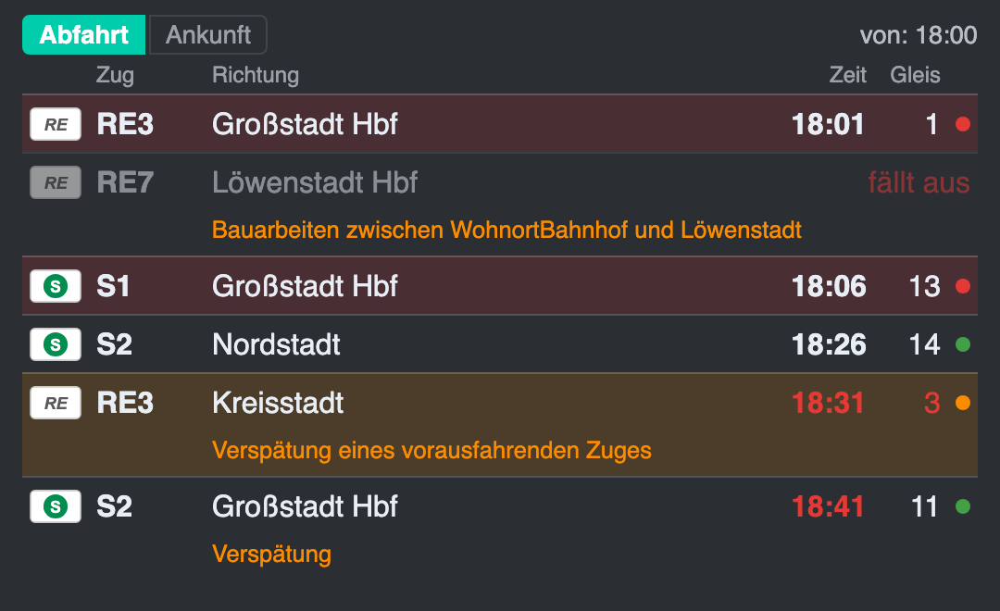

# IPSBahntafel

Bibliothek für IP-Symcon mit Bahn-Anzeigen aus der DB OpenBoards API.

Gedacht für das Tablet zu Hause: „Wann muss ich los?“ und „Wann kommt mein Besuch an?“. Eine Fahrplanauskunft mit Umstiegen ist es nicht.

## Module

| Modul | Beschreibung |
|---|---|
| [Bahntafel](Bahntafel/README.md) | Abfahrts- und Ankunftstafel eines Bahnhofs mit Echtzeitdaten, Zielbahnhof-Filter und Erreichbarkeit, als HTML-Box und Kachel |

## Voraussetzungen

- IP-Symcon ab 9.0
- Kostenloser Zugang zur DB OpenBoards API, siehe [Bahntafel: Zugang zur DB API](Bahntafel/README.md#zugang-zur-db-api)

## Installation

Über den Module Store oder in der Konsole unter *Module Control* die URL `https://github.com/captmajac/IPSBahntafel` hinzufügen.

## Konfiguration

Die Einstellungen der Instanz *Bahntafel* sind in vier aufklappbare Bereiche gegliedert.

**Zugang zur DB API**

| Einstellung | Bedeutung |
|---|---|
| Client-ID, API-Key | Zugangsdaten einer Anwendung im DB API Marketplace, die OpenBoards und OpenStation abonniert hat |
| Aktualisierungsintervall | Wie oft die Tafel abgerufen wird, 15 bis 240 Minuten, Standard 60. Ein Abruf sind 2 API-Aufrufe. |
| Verbindung testen | Prüft die Zugangsdaten und meldet den Namen des Bahnhofs |

**Heimat- und Zielbahnhof**

| Einstellung | Bedeutung |
|---|---|
| Bahnhofsname oder EVA-Nummer | Suchbegriff. Ein Name wird über OpenStation gesucht, eine 7-stellige EVA-Nummer direkt über OpenBoards. |
| Heimatbahnhof | Bahnhof der Tafel. Nach der Suche steht hier der erste Treffer, weitere Treffer sind wählbar. |
| Zielbahnhof | Optional. Abfahrt zeigt nur Züge nach diesem Bahnhof, Ankunft nur Züge von dort. „(alle Züge)“ zeigt alle. Die Liste füllt sich mit den Bahnhöfen der Züge, sobald ein Heimatbahnhof gewählt ist. |

**Anzeige**

| Einstellung | Bedeutung |
|---|---|
| Züge | Angezeigte Gattungen: Fernverkehr, Regionalverkehr, S-Bahn, Bus, Tram, Sonstige |
| Erweiterte Hinweise | Zusätzlich Hinweise wie „Ein Wagen fehlt“ oder „Heute nur einteilig“. Ohne Haken nur Verspätungsgründe und Störungen. |
| Zeilen auf der Tafel | 1 bis 20, Standard 10 |
| Instanz nach Bahnhof benennen | Benennt die Instanz und damit die Kachel nach dem Heimatbahnhof, nur auf Klick |

**Erreichbarkeit (nur Abfahrt)**

| Einstellung | Bedeutung |
|---|---|
| Wegezeit zum Bahnhof, entspannt | Minuten von zu Hause zum Bahnhof, 0 schaltet die Erreichbarkeit aus |
| davon zügig einsparbar | Minuten, die man zügig schneller ist. Züge in dieser Spanne gelten als *knapp*. |

Die Tafel markiert jeden Zug als *erreichbar* (grün), *knapp* (orange) oder *nicht erreichbar* (rot). Schritt für Schritt beschreibt es [Bahntafel: Einrichten](Bahntafel/README.md#4-einrichten-der-instanzen-in-ip-symcon).

Zum Entwickeln und lokalen Testen siehe [tests/README.md](tests/README.md).
